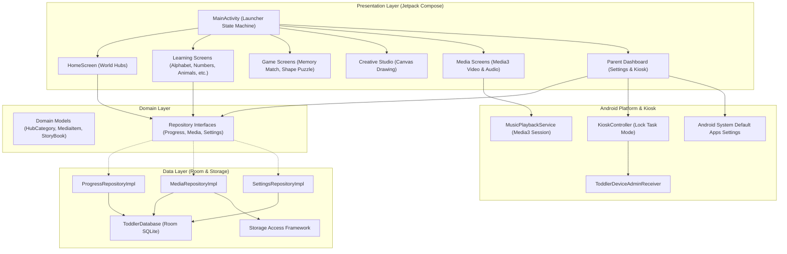

# ToddlerOS

> **A self-contained, offline-first Android Home Launcher and interactive learning environment designed exclusively for Vasu.**

ToddlerOS replaces the default Android home-screen experience with an engaging, distraction-free digital playground. It combines early-childhood educational activities, creative drawing tools, interactive games, and local multimedia playback within a child-friendly launcher environment.

ToddlerOS is an ordinary Android application that registers for the device's default `HOME` launcher category. It operates strictly within standard Android application boundaries and does not require a custom ROM, operating-system modifications, or third-party applications.

---

## Table of Contents

- [Project Overview](#project-overview)
- [Product Philosophy](#product-philosophy)
- [Key Features](#key-features)
- [Architecture](#architecture)
- [Technology Stack](#technology-stack)
- [Project Structure](#project-structure)
- [Prerequisites & Requirements](#prerequisites--requirements)
- [Getting Started](#getting-started)
- [Build Commands](#build-commands)
- [Secure Child Mode & Kiosk Setup](#secure-child-mode--kiosk-setup)
- [Privacy & Security](#privacy--security)
- [Development Guidelines](#development-guidelines)
- [Project Roadmap](#project-roadmap)
- [Troubleshooting](#troubleshooting)
- [License](#license)

---

## Project Overview

ToddlerOS is built around the philosophy that early childhood learning should be exploratory, self-paced, and joyful. Rather than acting as a gateway to external third-party apps or the web, ToddlerOS is **100% self-contained**: all learning modules, games, music, picture books, and creative tools are native components bundled directly within the application.

### Core Objectives

- **Safe Home Replacement**: Functions as an official Android `HOME` launcher, providing a consistent, predictable environment whenever the Home button is tapped.
- **Self-Contained Discovery**: All educational activities, games, and creative tools run natively inside the application without relying on external apps.
- **Complete Privacy & Offline Independence**: No network permissions, no user accounts, no cloud APIs, and zero analytics or advertisements.
- **Parental Peace of Mind**: Includes an optional Android Lock Task (Kiosk) mode and a password-protected parent exit interface.

---

## Product Philosophy

- **Exclusively for Vasu**: Designed around a single-child experience. There are no sibling profiles, multi-user switchers, or complex account setups.
- **Zero Third-Party App Handoffs**: ToddlerOS does not expose or launch external third-party applications. The child remains safely within ToddlerOS.
- **Encouraging, Non-Punitive Learning**: Activities celebrate every attempt with visual and auditory praise ("Wonderful, Vasu!", "You found it!"). Mistakes are treated gently without penalties or timers.
- **Child-Friendly Visual Ergonomics**: Uses soft, warm pastel palettes (sunny yellow, mint green, sky blue, peach, lavender) paired with deep slate text to ensure accessible WCAG AA/AAA contrast ratios and comfortable touch targets (48dp minimum).
- **Device Independent**: Dynamically adapts to varying screen resolutions, aspect ratios, densities, and orientations without assuming specific hardware configurations or vendor features.

---

## Key Features

### Status Legend
- `[x]` **Implemented**: Fully functional in the current codebase.
- `[-]` **Partially Implemented**: Working prototype present; enhancements planned.
- `[ ]` **Planned**: Scheduled for future milestones.

### 1. Launcher & Navigation
- `[x]` **Android HOME Launcher**: Registers standard `ACTION_MAIN`, `CATEGORY_HOME`, `CATEGORY_DEFAULT`, and `CATEGORY_LAUNCHER` intent filters.
- `[x]` **Personalized Header**: Greets Vasu ("Hello Vasu! 🌈"), displays real-time date/clock, and tracks earned activity stars.
- `[x]` **Four World Hubs**: Clean internal navigation across **Learn 🧩**, **Play 🚀**, **Create 🎨**, and **Discover 🎵**.
- `[x]` **Back Navigation Management**: Intercepts the back gesture during activities to navigate back to the home screen, while delegating the root launcher screen to the Android OS.

### 2. Early-Learning Modules (`Learn 🧩`)
- `[x]` **Alphabet Adventure**: Interactive letters A–Z featuring illustrated words, spoken phonics, and offline text-to-speech (TTS) pronunciation.
- `[x]` **Number Garden**: Visual tap-to-count activity with garden fruits and flowers, animated counters, and celebratory star rewards.
- `[x]` **Animal World**: Illustrated animals, their habitats, and authentic spoken animal sounds.
- `[x]` **Colors & Shapes**: Interactive discovery quests prompting Vasu to match colors and geometric shapes with positive audio encouragement.
- `[x]` **Fruits & Veggies**: Fresh produce recognition, nutritional fun facts, and spoken pronunciation.
- `[x]` **Vehicles & Transport**: Interactive cars, trains, airplanes, boats, and rockets with realistic audio effects and descriptions.

### 3. Interactive Games (`Play 🚀`)
- `[x]` **Memory Match**: Card-flipping animal pair matching game with shuffle capabilities and celebratory win states.
- `[x]` **Shape Puzzle**: Outline-matching and shape-sorting challenge with slot validation and audio reinforcement.

### 4. Creative Studio (`Create 🎨`)
- `[x]` **Drawing Canvas**: Freehand finger-drawing studio with touch tracking, multiple brush sizes (fine, medium, crayon), and an 8-color toddler palette.
- `[x]` **Local Artwork Saving**: Renders the canvas to a Bitmap and saves PNG artwork directly to internal app storage.
- `[x]` **Photo Gallery**: Gallery view displaying saved drawings and local pictures with full-screen zoom and swipe view.

### 5. Media & Discovery (`Discover 🎵`)
- `[x]` **Vasu's Tunes & Rhymes**: Background audio playback powered by AndroidX Media3 ExoPlayer, featuring skip, repeat, and shuffle controls.
- `[x]` **Vasu's Videos**: Fullscreen video library using Media3 ExoPlayer with automatic playback position persistence.
- `[x]` **Interactive Storybooks**: Picture-book stories with page-turn navigation and offline Android Text-to-Speech read-aloud support.

### 6. Parent Management Area
- `[x]` **Password-Protected Exit**: 6-digit numeric keypad with validation against a centralized development constant (`DEFAULT_PARENT_PASSWORD = "123456"`).
- `[x]` **Child Mode & Kiosk Controller**: Lock Task Mode status detection, Device Owner provisioning guide, and activation/deactivation triggers.
- `[x]` **Content Library Management**: Storage Access Framework (SAF) document picker allowing parents to link local device folders for videos, audio, and pictures.
- `[x]` **Learning Progress Dashboard**: Overview of total stars earned by Vasu across completed educational activities.
- `[x]` **Launcher Settings**: Toggle for in-app spoken narration and direct shortcut to Android's Default Home App system settings.

---

## Architecture

ToddlerOS is built using modern Android architecture principles with clear separation of presentation, domain, and data layers:



### Component Highlights

1. **Launcher Activity (`MainActivity.kt`)**: Acts as the central navigation host. It maintains the active screen state (`LauncherScreen`), intercepts back-press events within sub-screens to return to the home hub, and preserves state across configuration changes.
2. **Kiosk Controller (`KioskController.kt`)**: Interfaces with Android's `DevicePolicyManager`. When provisioned as a Device Owner, it configures `setLockTaskPackages` and locks down system features (`LOCK_TASK_FEATURE_NONE` on API 28+). When unmanaged, it falls back to standard Android Screen Pinning.
3. **Data Persistence (`ToddlerDatabase.kt`)**: Uses AndroidX Room with SQLite to track:
   - `LearningProgressEntity`: Activity completion timestamps and stars earned.
   - `MediaRecordEntity`: Persistable SAF URIs for locally imported videos, songs, and picture books.
   - `SettingEntity`: Key-value launcher configuration (e.g., narration toggles).

---

## Technology Stack

| Category | Technology | Version | Description |
| :--- | :--- | :--- | :--- |
| **Language** | Kotlin | `2.0.21` | Modern, concise, type-safe programming language |
| **UI Framework** | Jetpack Compose | `2024.10.01` (BOM) | Declarative UI toolkit with Material 3 components |
| **Build System** | Gradle / AGP | `9.6.0` / `8.7.3` | Gradle Kotlin DSL (`build.gradle.kts`) |
| **Code Generation** | Google KSP | `2.0.21-1.0.28` | Kotlin Symbol Processing for Room compilation |
| **Persistence** | AndroidX Room | `2.6.1` | Local SQLite object mapping and coroutine Flow support |
| **Media Playback** | AndroidX Media3 | `1.5.0` | ExoPlayer, MediaSession, and PlayerView |
| **Image Loading** | Coil Compose | `2.7.0` | Lightweight image and video frame decoder |
| **Asynchrony** | Kotlin Coroutines | `1.9.0` | Background task scheduling and reactive StateFlows |
| **Speech** | Android Native TTS | SDK Built-in | Offline text-to-speech for phonics and read-aloud |

---

## Project Structure

```
ToddlerOS/
├── .gitignore                          # Clean Android/Gradle ignore rules
├── build.gradle.kts                    # Root build configuration (AGP, Kotlin, KSP, Compose)
├── settings.gradle.kts                 # Project repositories and module inclusion
├── README.md                           # Project documentation
├── gradle/
│   └── wrapper/
│       ├── gradle-wrapper.jar          # Gradle wrapper executable
│       └── gradle-wrapper.properties   # Gradle 9.6.0 distribution reference
└── app/
    ├── build.gradle.kts                # Application dependencies, SDK targets, and Compose flags
    └── src/
        └── main/
            ├── AndroidManifest.xml     # HOME launcher declaration, services, and device admin
            ├── res/
            │   ├── drawable/           # Vector assets (launcher icons, backgrounds)
            │   ├── mipmap-anydpi-v26/  # Adaptive launcher icons
            │   ├── values/             # Colors, typography, strings, themes
            │   └── xml/
            │       └── device_admin_receiver.xml  # Device administration policy metadata
            └── java/com/toddleros/
                ├── ToddlerApp.kt       # Application class (database & service locator)
                ├── core/
                │   └── theme/          # Color tokens, typography, and Material 3 theme
                ├── domain/
                │   ├── model/          # HubCategory, MediaItem, StoryBook models
                │   └── repository/     # Media, Settings, and Progress repository interfaces
                ├── data/
                │   ├── local/          # ToddlerDatabase Room definition
                │   │   ├── dao/        # MediaDao, SettingsDao, ProgressDao
                │   │   └── entity/     # Room entities
                │   └── repository/     # Concrete repository implementations
                ├── kiosk/
                │   ├── KioskController.kt          # Lock Task Mode & Device Owner logic
                │   └── ToddlerDeviceAdminReceiver.kt # BroadcastReceiver for device policy
                ├── launcher/
                │   └── MainActivity.kt # Main HOME launcher Activity & state machine
                └── ui/
                    ├── home/           # HomeScreen, HomeHeader, HubTabRow, hub sections
                    ├── learning/       # Alphabet, Numbers, Animals, Colors, Produce, Vehicles, Puzzles
                    ├── content/        # Video, Music, Photo, and Story viewer screens
                    └── parent/         # Parent dashboard, password keypad, and settings
```

---

## Prerequisites & Requirements

### Developer Environment
- **Java Development Kit (JDK)**: JDK 17 or higher (tested with Microsoft / OpenJDK 17 and 21)
- **Android Studio**: Ladybug (2024.2.1) or newer
- **Android SDK Platform**: API Level 35 installed via SDK Manager
- **Build Tools**: `35.0.0`

### Target Device Compatibility
- **Minimum SDK (`minSdk`)**: API 26 (Android 8.0 Oreo)
- **Target SDK (`targetSdk`)**: API 31 (Android 12)
- **Compile SDK (`compileSdk`)**: API 35 (Android 15)
- **Architecture**: Universal (ARM64, ARMv7, x86_64)

---

## Getting Started

### 1. Clone the Repository
```bash
git clone https://github.com/your-username/ToddlerOS.git
cd ToddlerOS
```

### 2. Open in Android Studio
1. Launch Android Studio.
2. Select **Open** and choose the root `ToddlerOS` folder.
3. Allow Gradle to synchronize dependencies.

### 3. Build the Application
Run the build task from Android Studio (**Build > Make Project**) or via terminal:
```bash
./gradlew assembleDebug
```

### 4. Install onto Device
Connect your Android device via USB with USB Debugging enabled:
```bash
adb install -r app/build/outputs/apk/debug/app-debug.apk
```

### 5. Set ToddlerOS as Default Launcher
1. Press the **Home** button on the device.
2. Select **ToddlerOS** when prompted and tap **Always**.
3. *Note*: You can return to your original launcher at any time via Android Settings (*Settings > Apps > Default Apps > Home app*).

---

## Build Commands

Execute these Gradle commands from the project root.

### Linux / macOS (Bash)
```bash
# Clean previous build caches
./gradlew clean

# Build the Debug APK
./gradlew assembleDebug

# Build the Release APK (requires signing configuration)
./gradlew assembleRelease

# Run unit tests
./gradlew test
```

### Windows (PowerShell)
```powershell
# Clean previous build caches
.\gradlew.bat clean

# Build the Debug APK
.\gradlew.bat assembleDebug

# Build the Release APK
.\gradlew.bat assembleRelease

# Run unit tests
.\gradlew.bat test
```

Compiled APK output path:
```
app/build/outputs/apk/debug/app-debug.apk
```

---

## Secure Child Mode & Kiosk Setup

ToddlerOS implements Android's official `DevicePolicyManager` Lock Task Mode.

### How Kiosk Mode Works
When Secure Child Mode is active:
- The notification shade and Quick Settings are blocked from pulling down.
- System navigation (Home, Overview/Recent Apps) is restricted.
- Application switching is prevented.
- Physical power and volume buttons remain functional.

### Provisioning Device Owner (Optional for Strict Kiosk)
To activate Lock Task Mode without user confirmation dialogs:
1. Ensure the device has **no user accounts** registered (or is freshly factory reset).
2. Connect the device via USB and run:
   ```bash
   adb shell dpm set-device-owner com.toddleros.launcher/.kiosk.ToddlerDeviceAdminReceiver
   ```
3. Open ToddlerOS > Parent Dashboard > **Child Mode & Kiosk** tab to confirm the `Provisioned ✅` status.

*(Note: If Device Owner is not provisioned, ToddlerOS falls back gracefully to standard Android Screen Pinning mode).*

### Exiting Child Mode
1. Tap the discreet **Gear** icon in the upper-right corner of the screen.
2. Enter the six-digit parent password on the custom numeric keypad:
   ```
   Default Development Password: 123456
   ```
3. Upon validation, Lock Task Mode disengages, restoring normal Android navigation.

### Emergency Device Recovery
If the device needs to be recovered or unpinned via ADB:
```bash
# Force stop ToddlerOS
adb shell am force-stop com.toddleros.launcher

# Remove Device Owner privileges (if provisioned)
adb shell dpm remove-active-admin com.toddleros.launcher/.kiosk.ToddlerDeviceAdminReceiver

# Reset default launcher to a system launcher
adb shell cmd package set-home-activity <package-name-of-original-launcher>

# Uninstall ToddlerOS
adb shell pm uninstall com.toddleros.launcher
```

---

## Privacy & Security

- **100% Offline Operation**: ToddlerOS requests zero internet permissions (`android.permission.INTERNET` is absent from the manifest).
- **No Analytics or Telemetry**: No trackers, Firebase SDKs, crash reporters, or third-party telemetry libraries are integrated.
- **Local Storage Only**: All settings, learning progress, and drawings are stored in SQLite (Room) or app-specific private storage (`context.filesDir`).
- **Standard Permissions**: Requests only `android.permission.FOREGROUND_SERVICE` for audio playback. Privileged system permissions (`WRITE_SETTINGS`, `MODIFY_AUDIO_SETTINGS`, `WAKE_LOCK`) are strictly prohibited.
- **Password Notice**: The default password (`123456`) is a development constant intended for testing. Production deployments should replace this with a parent-configured salted hash in SQLite.

---

## Development Guidelines

1. **Single Responsibility Principle (SRP)**: Each Kotlin file must handle a single concern. Avoid bloated monoliths or placing multiple UI screens in one file.
2. **Offline Assets**: All educational content (emojis, vector drawables, text-to-speech phrases) must be locally bundled. Never link remote URLs.
3. **WCAG AAA Color Contrast**: Ensure all text elements meet accessible contrast standards (>7:1 for body text against soft pastel backgrounds).
4. **Touch Ergonomics**: All interactive elements must maintain a minimum touch target size of 48×48dp, with app tiles exceeding 100dp in height.
5. **Encouraging Tone**: All spoken and visual messages must remain positive, encouraging, and celebrate learning without negative feedback.

---

## Project Roadmap

### Milestone 1 — Core Architecture `[Completed]`
- [x] Native Kotlin + Jetpack Compose project configuration with Gradle 9 and AGP 8.7.
- [x] Standard Android `HOME` launcher intent filters.
- [x] WCAG-compliant design system and typography tokens.
- [x] Room database foundation for media, progress, and preferences.

### Milestone 2 — Early-Learning Platform `[Completed]`
- [x] Interactive Alphabet Adventure with offline TTS phonics.
- [x] Number Garden counting challenge.
- [x] Animal World with habitat cards and sounds.
- [x] Colors & Shapes recognition quests.
- [x] Fruits & Vegetables produce discovery.
- [x] Vehicles & Transportation explorer.
- [x] Shape sorting puzzle challenge.
- [x] Memory matching card game.

### Milestone 3 — Creativity & Media `[Completed]`
- [x] Interactive Creative Studio with canvas drawing, brush thickness, and local PNG saving.
- [x] Photo gallery for viewing saved artwork.
- [x] Media3 ExoPlayer background audio player.
- [x] Fullscreen video player with position resume.
- [x] Picture book reader with offline TTS.

### Milestone 4 — Secure Child Mode & Parent Portal `[Completed]`
- [x] 6-digit numeric keypad parent exit dialog.
- [x] DevicePolicyManager Lock Task Mode integration and DeviceAdminReceiver.
- [x] 4-tab parent dashboard (Kiosk, Content, Progress, Launcher Settings).
- [x] Documented ADB recovery procedures.

### Milestone 5 — Polish & Future Enhancements `[Planned]`
- [ ] Parent-configurable password storage replacing the default development constant.
- [ ] Additional jigsaw puzzles with customizable piece counts.
- [ ] Customizable theme color palettes within parent settings.
- [ ] Audio volume caps tailored for toddler hearing protection.

---

## Troubleshooting

### "Default Activity not found" error in Android Studio
- **Cause**: Android Studio's default run configuration searches specifically for `CATEGORY_LAUNCHER`.
- **Solution**: Ensure `MainActivity` in `AndroidManifest.xml` declares `android.intent.category.LAUNCHER` alongside `android.intent.category.HOME`.

### "Unable to download toolchain" during Gradle build
- **Cause**: An explicit `gradle-daemon-jvm.properties` file requested an uninstalled JDK toolchain.
- **Solution**: The file has been excluded. Ensure Android Studio uses an installed JDK 17 or JDK 21 in **Settings > Build, Execution, Deployment > Build Tools > Gradle**.

### Back button does not exit ToddlerOS
- **Expected Behavior**: ToddlerOS is an Android HOME launcher. The Android OS naturally prevents back-press exits on the root home screen. To exit to another launcher, use Android System Settings (*Settings > Apps > Default Apps > Home app*) or the shortcut in ToddlerOS Parent Settings.

---

## License

Licensing decision is currently **Pending**. All rights reserved.
